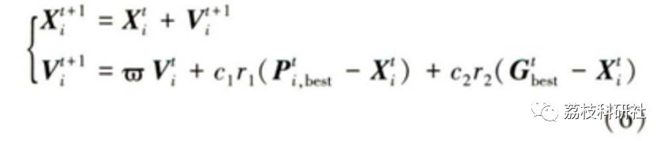
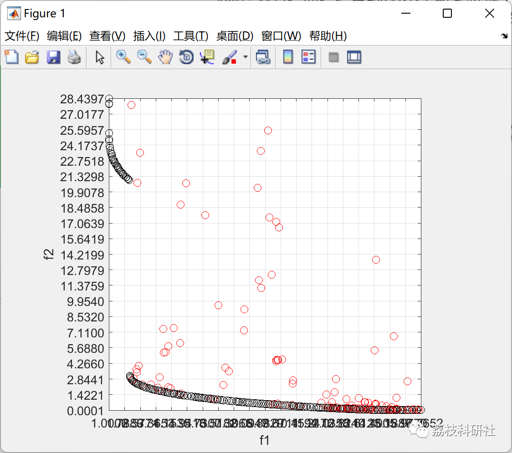
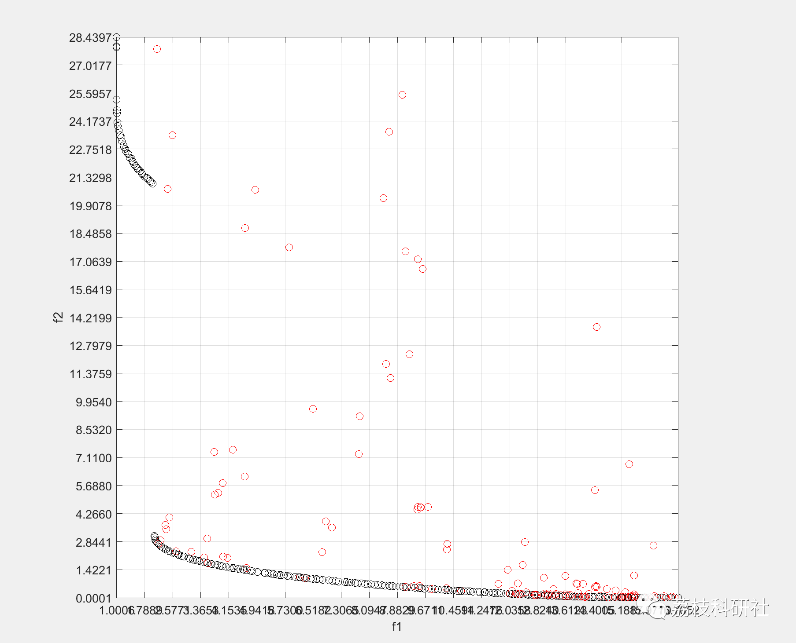

# Multi-Objective Particle Swarm Optimization Algorithm (MOPSO) (Matlab Code Implementation)

💥💥💥💞💞💞 Welcome to this blog❤️❤️❤️ 💥💥💥
🏆 Bloggers' Advantages: 🌞🌞🌞 The content of the blog strives for rigorous thinking and clear logic to facilitate readers.
⛳️ Mantra: A journey of a thousand miles is begun with a single step.
Litchi Research Society
Code Collection: Power Systems, Intelligent Algorithms and Applications, Neural Network Prediction, Path Planning, Optimized Scheduling, Workshop Scheduling, Image Processing, Signal Processing...
🎁 Special Section Links:
🌈🌈🌈🌟🌟🌟 Electrical Code Intelligent Algorithms and Their Applications Path Planning Neural Network Prediction Optimized Scheduling Image Processing Workshop Scheduling Signal Processing Romantic Her Thoughts Math Modeling Complete Code Issues
💥1 Overview
The Multi-objective Particle Swarm Optimization (MOPSO) algorithm was proposed by Carlos A. Coello C in 2004, which extends the single-objective particle swarm optimization algorithm to multi-objective optimization problems. The MOPSO algorithm uses the concept of Pareto dominance to determine the flight direction of particles, and non-dominated individuals are determined by comparing the dominance relationships between particles and stored in the global elite library REP. Based on the density adaptive grid estimation method, the global optimal solution individual Gsest is selected from the global elite library, and the individual historical best solution Pest is selected based on the dominance relationship comparison between the new and old generation population individuals. Subsequently, the formula (6) is used to continuously update the velocity and position of the particle swarm, ultimately obtaining a set of non-dominated solutions that cover the entire search space, distribute evenly, and are close to the true Pareto frontier with minimal computational resources.
📚2 Running Results
🎉3 References
[1] Liu Junxian, Wang Hongqiang, Tao Xinlong. Radar resource allocation method based on improved multi-objective particle swarm optimization algorithm [J]. China Academy of Engineering Science Journal, 2022, 17(6): 549-556
[2] Wang Wanliang, Jin Yawen, Chen Jiachen, Li Guoqing, Hu Mingzhi, Dong Jianhang. Multi-role, Multi-strategy, and Multi-objective Particle Swarm Optimization Algorithm [J]. Journal of Zhejiang University: Engineering Edition, 2022, 56(3): 531-541  
🌈4 Matlab Code Implementation  
Click the left bottom corner of the article to read more.

## Images

<!-- PAYMENT_BLOCK -->

## Get this dataset

- Payment link (Stripe): [Buy now](https://buy.stripe.com/3cs8yP7sY87d0vu9AB)
- Payment QR code: 

<!-- /PAYMENT_BLOCK -->
